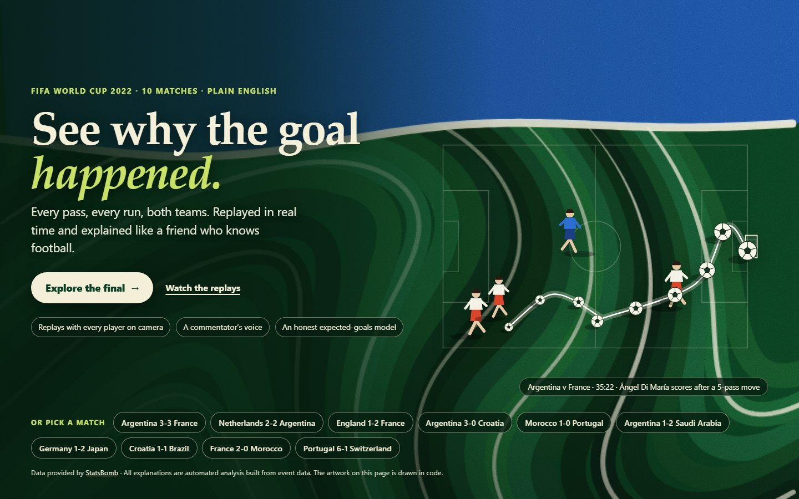
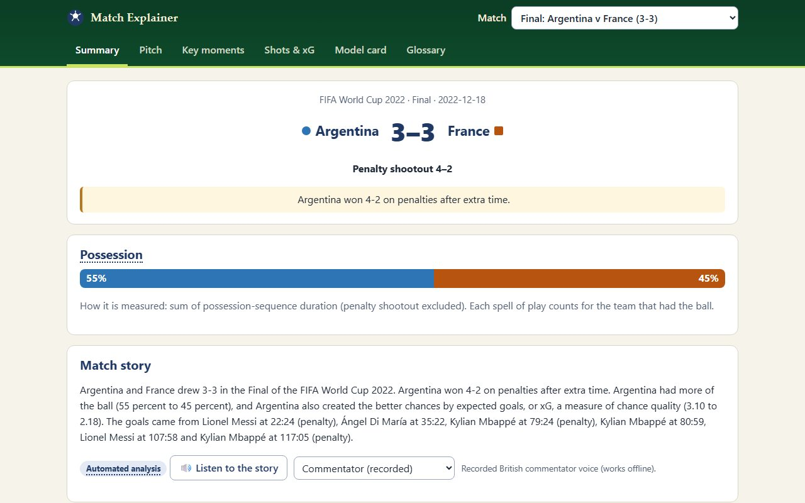
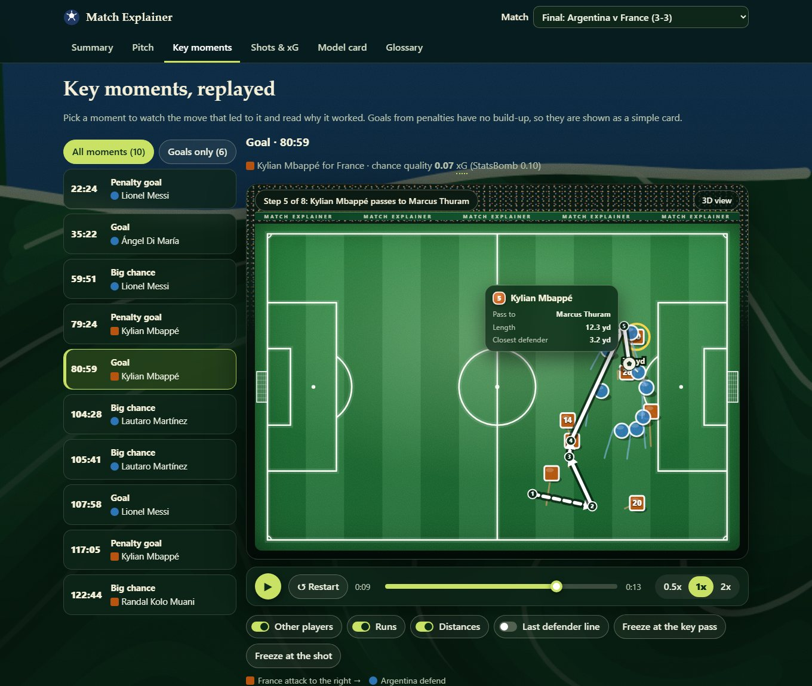
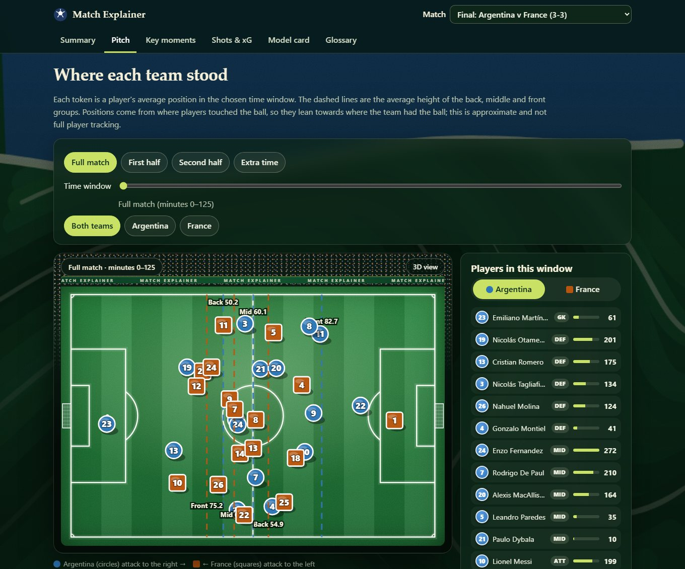
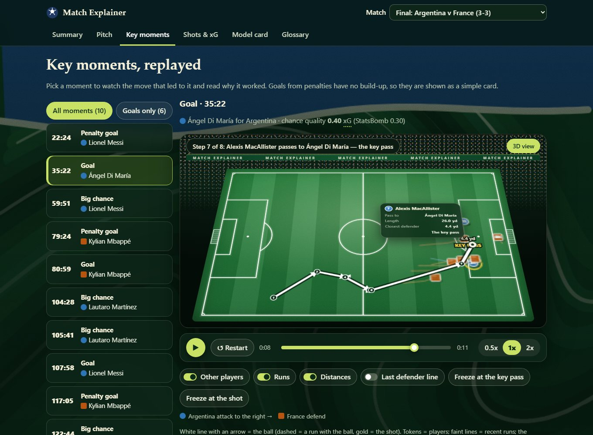

# Match Explainer

**Live site: https://alwinjose-9811.github.io/match-explainer/**

Explains finished football matches to complete beginners: plain-English statistics, a tactical pitch view, animated
replays of the key moments, and a trained expected-goals (xG) model with an honest model card.

An offline Python pipeline turns free [StatsBomb open data](https://github.com/statsbomb/open-data) into a small bundle of
JSON files; a static website (vanilla JavaScript + SVG, no framework, no backend) reads it. It works offline and loads
nothing from third parties. Ten 2022 World Cup matches are included (the final, Argentina v Saudi Arabia, Germany v Japan, Croatia v Brazil,
France v Morocco, Portugal v Switzerland and more), with the final (Argentina 3-3 France) as the default.

## Quick start

View the site (needs only Python 3.10+, no installs, the processed data is in the repository):

```
git clone https://github.com/AlwinJose-9811/match-explainer.git
cd match-explainer
python tasks.py serve
```

Then open http://localhost:8000.



The site opens on a landing page: a flowing "liquid pitch" background, the real path of a World Cup goal drawn as a
multi-exposure ball trail, and one-click entry to the final or any of the ten matches. It is drawn entirely in code
(canvas and SVG, no images or fonts are loaded), keeps still for people who prefer reduced motion, and pauses when the
tab is hidden. The pages inside keep light cards on a deep-green header.

The pages inside use a "stadium night" look: dark glass panels over the same liquid-pitch backdrop, a lime accent, a
fixtures strip to jump between matches, and a floodlit pitch (mowing stripes, glowing lines, goals with nets, a crowd and
advertising boards) with an optional tilted 3D camera.



The key-moment replay has a glass control bar, switches for the other players, runs, distances and the last-defender line,
a floating card for the player on the ball (what he did, how long, how far the closest defender is, and the chance quality
of a shot), and panels listing the move and its players:







## What is in the site

| Page | What it shows |
|---|---|
| Summary | Score, possession (and how it is measured), plain-English stats table, match story, **Listen** button |
| Pitch | Average positions per player, back/mid/front lines, team shape, a time-window slider |
| Key moments | Goals and big chances replayed in real time: the ball path (bold, always on top) plus every player visible on camera for **both teams**, with their estimated runs, a live last-defender line, and a "why it worked" line |
| Shots & xG | Shot map (marker size = chance quality) and a table of every shot |
| Model card | Data, features, metrics against baselines and StatsBomb's xG, calibration, limits |
| Glossary | 35 football and machine-learning terms; every underlined label also explains itself on hover or tap |

## Rebuild everything from raw data

The raw data is large (about 1 GB) and is not in the repository. It is fetched into `C:/mx-data` by default
(change `raw_dir` in `config/default.json` or set `MX_RAW_DIR`).

```
python -m venv C:/mx-data/venv
C:/mx-data/venv/Scripts/activate
python tasks.py setup
python tasks.py fetch
python tasks.py verify
python tasks.py train
python tasks.py build
python tasks.py test
```

`python tasks.py all` runs verify, train, build and test. To add a match:
`python -m pipeline.run_pipeline --match-id <id>` (any match with StatsBomb event data; 360 data is optional).

## How it works

`load` -> `normalize` (120 x 80 pitch, shootout excluded) -> `metrics` / `positions` / `moments` (key moments,
build-up, 360 snapshots) -> `xg_features` / `xg_train` / `xg_predict` -> `explain` (template text checked against the
facts) -> JSON in `data/processed/<match_id>/`, copied to `web/data/`. Design documents are in `docs/`; where reality
differed from the original plan, `docs/CORRECTIONS.md` wins. `docs/ACCEPTANCE.md` lists every requirement as done, cut
or partial, and `docs/DEMO.md` has the demo script.

## The xG model, honestly

Logistic regression on pre-shot features only (distance, angle, body part, technique, play pattern, goalkeeper and
defender positions). Trained on 22,306 shots from 877 league matches, tested on 1,234 shots from UEFA Euro 2020
(a competition it never saw; the 2022 World Cup is never trained on).

| Model | Log loss (lower is better) | ROC AUC |
|---|---|---|
| Average chance for every shot | 0.323 | 0.500 |
| Distance and angle only | 0.290 | 0.736 |
| **Our model** | **0.264** | **0.794** |
| StatsBomb's own xG (richer data) | 0.251 | 0.812 |

It beats the baselines, is well calibrated (error 0.017), and lands behind StatsBomb's model, as expected.

## Limits

- Event data has no continuous tracking. Positions are averages of where players touched the ball, and the tactical
  labels (low block / mid block / high line) are approximate and relative to these ten matches.
- 360 snapshots show only players visible on the TV picture, so the real last defender is sometimes missing.
- The data has no full player tracking. Off-the-ball movement is **reconstructed**: each on-ball event carries an
  anonymous snapshot of the visible players, the same player is matched between snapshots and the path is smoothed.
  Checked against the event data over 369 actions in the ten matches, the passer's reconstructed position is within 0.6
  yards at the median (1.9 yards at the 90th percentile, 13 at worst); in between snapshots (up to about 6 seconds apart)
  the exact route is an estimate. Players off camera are not shown, and 2 of the 63 replays have a single snapshot and are ball-only.
- Penalties use one fixed chance (79%); they are shown as a simple card with no build-up.
- Explanations are templates filled with facts from the data and labelled **Automated analysis**. No language model is used.
- Only ten matches are included; more need the build steps above and are limited to matches in StatsBomb's free data.
- The Listen button plays a recorded commentary in a British male neural voice (Kokoro, rendered offline, so it works on
  any device without internet). The script is written to be heard (numbers as words, excitement on goals, a pause before a
  penalty). English voices tend to stumble on some foreign names. If a clip is missing the site falls back to the browser's
  own voice, which can also be chosen in the voice picker (Microsoft Edge has natural voices; the basic Windows ones are robotic).
  Re-render with `python tasks.py voice` (needs `requirements-voice.txt` and the model files, see `pipeline/voice.py`).

## Data and attribution

Data provided by [StatsBomb](https://github.com/statsbomb/open-data) (the repository is now under the Hudl organisation; the old
link redirects). StatsBomb's terms ask anyone publishing analysis based on the data to credit StatsBomb as the source and to use
their logo from their Media Pack. The credit and link are on every page; **the logo is not included yet** (it comes from the
Media Pack, so it has to be added by the project owner). No broadcast footage is used or hosted.

## Publishing the live site

The site is served by GitHub Pages from the `gh-pages` branch, which holds a copy of the `web/` folder. After changing anything
under `web/`, commit it and run `python tasks.py publish`; the live site updates within a minute or two.

## Tests

`python tasks.py test` runs 100+ tests: unit tests, checks of every output against its JSON schema, an independent
recount of the match statistics, the leakage guard for the model, text grounding, contrast ratios and the web code.
